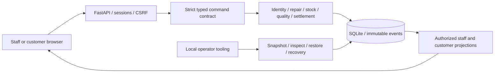

# BenchFlow architecture

BenchFlow is a local modular monolith: a same-origin HTML/CSS/JavaScript interface, a FastAPI command/projection boundary, and SQLite. The shipped runtime is Windows x64 with CPython 3.13, one Uvicorn worker, fixed loopback origin and local filesystem storage.

## State comes from facts

A repair has independent permission, estimate, stock, work, quality, balance and custody gates. A status selector cannot bypass them. Material estimate revision holds repair work; accepting a new estimate does not satisfy stock or quality gates. Diagnostic permission and exact-version repair approval are separate records. Failed quality checks require attributable rework and retesting. Recorded payment does not imply collection. An unrepaired return requires its own explicit disposition and collector authorization.

## Command and transaction boundary

`contracts/actions.py` defines a closed catalog of 58 actions, strict data schemas, exact expected revision keys and target shapes. `POST /api/v1/commands` validates those fields before domain execution. The backend also enforces roles, resource ownership/assignment, child membership and business invariants. Writes use SQLite `BEGIN IMMEDIATE`, foreign keys and durable commits. The same transaction records the audit event and idempotency result. Reusing an operation ID with a different payload is rejected.

Reads are typed authorized projections rather than raw table dumps. Customers see only linked service history and safe decisions. Error responses use stable public codes and request references; internal diagnostics remain private. The frontend builds forms and review screens around the command contract and refreshes after confirmed writes. Uncertain writes require checking the original operation, not blind retries.

## Domain modules

- `identity.py`, `credentials.py`, `recovery.py`: accounts, sessions, roles, invitations and controlled access recovery.
- `customers.py`, `repairs.py`: intake, permissions, estimate versions, consent, disposition and follow-up.
- `stockwork.py`: stock ledger, planned orders, reservations, task scope and work lifecycle.
- `settlement.py`: quality readiness, append-only money records, collector authorization and returns.
- `queries.py`, `views.py`: role-safe projections; `commands.py` coordinates mutations and audit.
- `database.py`, numbered SQL migrations and `backups.py`: schema validation, locking, snapshots and recoverability.

## Recovery and limits

Migration checksums, ordered history, SQLite integrity and foreign-key checks must agree. The service owns an exclusive operating-system lock for its data root. Snapshot/restore is an explicit local operator flow with hash validation, pre-restore preservation and authentication invalidation. Recovery tests compare business tables across restore and restart.

A single Windows host and SQLite are deliberate boundaries, not a multi-tenant or highly available deployment. There is no background message delivery, payment processing, supplier integration, telemetry or hosted AI dependency. See [security](docs/SECURITY.md), [operations](docs/RUNBOOK.md), [cost assumptions](COSTS.md) and [third-party notices](THIRD_PARTY_NOTICES.md).
