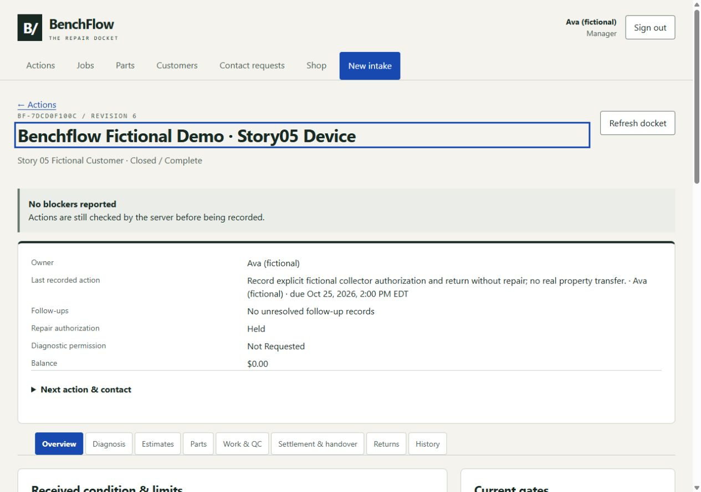

# BenchFlow

**A repair docket that keeps permission, parts, quality and custody accountable.**

BenchFlow is a working local repair-shop application with separate staff and customer views. It is built around a practical rule: a status change cannot substitute for customer permission, current scope, available stock, passed quality checks or an explicit property handover.



## What it demonstrates

- Separate diagnostic permission and exact-version estimate approval. Material estimate changes put work on hold; stale approval cannot authorize new scope.
- Attributable assignments, follow-ups, contact attempts and findings. No response never becomes implied consent or a fee.
- Integer stock movements, planned orders and atomic reservations, including contention for the last unit.
- Authorized work, immutable quality-check profiles, failed checks and linked rework/retests.
- Append-only manual financial records, corrections/refunds and explicit collector authorization. Recorded payment and property handover are separate gates.
- Linked returns with fresh permissions and coverage assessment, plus account-safe customer history and estimate decisions.
- Typed commands, revision checks, idempotency, role/ownership isolation, forward-only migration checks and tested backup/restore/restart.

The application records activity; it does not send messages, purchase parts, process money or verify real-world work. All demonstration screenshots use fictional data.

## Run locally

Supported target: **Windows x64, CPython 3.13**. The service binds only to **http://127.0.0.1:8000**. Port collisions fail; remote/LAN exposure and alternate ports are intentionally unsupported.

In PowerShell from the project folder:

```powershell
.\infra\Setup.ps1 -Dev
.\infra\Start.ps1 -Demo
```

Setup creates an isolated `.venv` and installs pinned, hash-verified binary dependencies. It uses the package index unless `-Offline` is supplied with a separately obtained compatible `infra/wheels` cache. Downloaded wheels and environments are excluded from the source candidate. Python itself must already be installed. No packages are silently upgraded as a recovery strategy.

Open the local application. For the isolated demo, open `/demo.html`, retrieve the one-time fictional credentials, retain them privately while switching personas, then clear the display. Reloading/restarting the isolated demo rotates credentials and preserves its fictional story records. Never put passwords in a screenshot, URL, source file or issue. Demo payments and collection are visibly simulated. Normal-mode collector authorization and unrepaired return are separate controls; demo simulation intentionally supports the completed-repair example only.

Run `Health.ps1` or `Stop.ps1` from a second terminal. Keep the foreground supervisor open. Normal-mode first-manager bootstrap, offline recovery and restore require deliberate host operator actions documented in the [runbook](docs/RUNBOOK.md). Use fictional data until host confidentiality, retention and recovery policies are established.

## Verify

```powershell
.\.venv\Scripts\python.exe -m pip check
.\.venv\Scripts\python.exe -m pytest tests backend/tests infra -q
node frontend/verify.js
```

The explicit Python paths matter: the shorter default pytest command does not include every backend/infrastructure check. Node.js is needed only for the frontend contract checks. The prepared Windows [CI workflow](.github/workflows/verify.yml) runs the same checks; it has not been executed remotely.

Tests cover isolated HTTP-connected repair scenarios, schema/history drift, identity/ownership boundaries, command handlers, and backup/recovery. Frontend contract checks exercise all 58 action forms against the shared parser. Browser evidence separately covers fictional core/exception journeys, review/confirmation, customer projections, keyboard entry/escape and narrow-screen reflow. Native offline and browser-zoom controls were unavailable in the browser test harness; transport-failure tests and 320/390 CSS-pixel reflow checks are documented equivalents, not claims of native offline/zoom testing. No blanket accessibility, penetration-test or load-capacity certification is claimed.

## Design and operating limits

[Architecture](ARCHITECTURE.md) · [Operations and recovery](docs/RUNBOOK.md) · [Security](docs/SECURITY.md) · [Cost assumptions](COSTS.md) · [Dependency notices](THIRD_PARTY_NOTICES.md)

SQLite and a single Windows host are deliberate limits. Data and backups are not encrypted by the application. There is no hosted deployment, remote integration, multi-tenant service or high-availability claim. The source candidate excludes runtime binaries, private evidence, company operating records and customer databases. A binary installer would need a separate native dependency and redistribution review.

## License

Original BenchFlow code is [MIT licensed](LICENSE). Dependencies keep their own licenses; their reproduced notices are in [THIRD_PARTY_NOTICES.md](THIRD_PARTY_NOTICES.md). This is a local source candidate prepared for owner review; no publication or deployment is implied.
